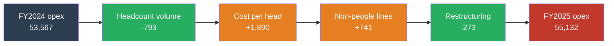

<div align="center">

# Citigroup FY2025
### Operating Expense Variance & Capital Analysis

*FY2024 (recast) → FY2025 (reported) · Source: Form 10-K filed 2026-02-20 · $mm unless stated*

-c0392b?style=flat-square)


</div>

---

## 1. Executive summary

> **The restructuring charge is gone. The cost is not.**
> Restructuring swung from a **$259mm charge to a $14mm credit**, yet reported operating expenses **rose $1,565mm (+2.9%)**. On an underlying basis (excluding divestiture items and the FDIC special assessment) they rose **$1,447mm (+2.7%)**.

| # | What the data says | Evidence |
|:-:|---|---|
| 1 | **Fewer people, higher cost per person** | Average headcount −2.8%; comp per head +6.8% |
| 2 | **Volume saving was overwhelmed by rate/mix** | Volume **−$793mm** vs rate/mix **+$1,890mm** |
| 3 | **Efficiency improved on revenue, not cost** | Revenue +5.6%; efficiency ratio 66.4% → 64.7% |
| 4 | **Capital ratio fell on RWA growth, not erosion** | CET1 capital +$1,736mm; RWA +$52,186mm (+4.6%) |
| 5 | **Regulatory headroom remains comfortable** | 13.18% vs 11.60% requirement = **1.58pp** |

---

## 2. Key metrics

| Metric | FY2025 | FY2024 | Change |
|---|---:|---:|---:|
| Total revenues | 85,225 | 80,722 | +5.6% |
| **Operating expenses (reported)** | **55,132** | **53,567** | **+2.9%** |
| Operating expenses (underlying) | 54,493 | 53,046 | +2.7% |
| Compensation and benefits | 29,639 | 28,542 | +3.8% |
| Restructuring | (14) | 259 | −273 |
| Efficiency ratio (reported) | 64.7% | 66.4% | −1.7pp |
| Year-end employees | 226,000 | 229,000 | −1.3% |
| Average employees | 227,500 | 234,000 | −2.8% |
| Comp per average employee | $130,281 | $121,974 | +6.8% |
| **CET1 ratio (Standardized)** | **13.18%** | **13.63%** | **−45bp** |

### Three-year view: what one year hides

| | FY2023 | FY2024 | FY2025 |
|---|---:|---:|---:|
| Reported opex | 55,970 | 53,567 | 55,132 |
| &nbsp;&nbsp;YoY | — | −4.3% | **+2.9%** |
| Underlying opex | 53,892 | 53,046 | 54,493 |
| &nbsp;&nbsp;YoY | — | −1.6% | **+2.7%** |
| Efficiency ratio | 71.7% | 66.4% | 64.7% |
| Year-end employees | 239,000 | 229,000 | 226,000 |
| Restructuring | 781 | 259 | (14) |

---

## 3. Expense bridge: FY2024 → FY2025



| Step | $mm | Reading |
|---|---:|---|
| Headcount volume | **−793** | Favourable: average heads 234.0k → 227.5k |
| Cost per head (rate/mix) | **+1,890** | Unfavourable: severance, FX, incentive pay, grade mix. **Not wage inflation alone** |
| Non-people lines (ex-restructuring) | **+741** | Includes $726mm Mexico goodwill impairment; only +$15mm without it |
| Restructuring line | **−273** | $259mm charge → $14mm credit |
| **Net change** | **+1,565** | Bridge closes to reported opex with no plug |

> Citi cited ~$400mm of higher severance in Q2 2025 alone, about 21% of the rate effect. Volume and rate carry opposite operational implications and are **never netted**.

### Reported to underlying

| | FY2025 | FY2024 | Change |
|---|---:|---:|---:|
| Reported opex | 55,132 | 53,567 | +1,565 |
| Less: divestiture-related | (877) | (318) | (559) |
| Less: FDIC special assessment | 238 | (203) | 441 |
| **Underlying opex** | **54,493** | **53,046** | **+1,447** |

---

## 4. Capital: CET1 walk

| | $mm |
|---|---:|
| Opening CET1 (31-Dec-2024) | 155,363 |
| + Net income | 14,306 |
| − Dividends (5,372) and buybacks (13,250) | (18,622) |
| + Other movements *(derived balance; AOCI change 5,955, unexplained 97)* | 6,052 |
| **Closing CET1 (31-Dec-2025)** | **157,099** |

| Ratio driver | bp |
|---|---:|
| CET1 capital growth (+1.1%) | +15 |
| RWA growth (+4.6%) | −60 |
| **Change in CET1 ratio** | **−45** |

| Requirement stack | % |
|---|---:|
| Basel III minimum | 4.50 |
| Stress capital buffer | 3.60 |
| G-SIB surcharge (Method 2, binding) | 3.50 |
| **Total requirement** | **11.60** |
| **Closing ratio** | **13.18** |
| **Headroom** | **1.58pp** *(Citi states ~160bp)* |

---

## 5. How the model works

| Sheet | Role | Hardcodes |
|---|---|:-:|
| `README` | Purpose, live checks, limits, method notes | No |
| `RAW_Data` | Evidence log: 51 sourced figures with exhibit, URL and date | **Yes (only place)** |
| `Inputs` | Two test tolerances | Parameters |
| `OPEX_YoY` | Expense lines, footing checks, underlying basis | No |
| `Variance` | Volume/rate split, total-opex waterfall, reconciliation | No |
| `Regulatory` | CET1 walk, ratio drivers, requirement and headroom | No |
| `Dashboard` | One-page CFO view | No |

**Colour code:** 🔵 blue = input · ⚫ black = formula · 🟢 green = cross-sheet link

```
Volume = (FY25 avg employees − FY24 avg employees) × FY24 comp per head
Rate   = (FY25 comp per head − FY24 comp per head) × FY25 avg employees
Volume + Rate = Δ comp and benefits  (exact by algebra, check cell = 0)
```

### Integrity checks: 11 / 11 PASS

| Check | Result |
|---|:-:|
| FY2025 and FY2024 expense lines foot to reported totals | ✅ |
| Total-opex bridge ends on reported 55,132 | ✅ |
| People-cost bridge arithmetic | ✅ |
| Reported-to-underlying reconciliation | ✅ |
| CET1 ratio vs 10-K stated ratio | ✅ |
| Requirement stack vs 10-K stated 11.6% | ✅ |
| Headroom vs Citi-stated 160bp | ✅ |
| CET1 ratio drivers sum to total change | ✅ |
| Reported opex less impairment vs Citi-adjusted $54.4B | ✅ |
| Efficiency-ratio improvement vs Citi-stated 170bp | ✅ |

*The `RAW_Data` sheet was also audited and contains zero formulas.*

---

## 6. Where earlier drafts and the filings differed

| Item | Earlier draft | Filing shows | Treatment |
|---|---|---|---|
| FY2023 / FY2024 opex | ~$56.4B / ~$53.9B | **55,970 / 53,567** (recast) | Recast used for like-for-like |
| Headcount target | ~180,000 as 2025 target | End-2026 aspiration incl. ~40,000 via Mexico IPO | Not used as benchmark |
| Severance location | All in restructuring | Also inside comp and divestiture costs | Restructuring shown separately |
| FDIC special assessment | Accrual change | P&L charge (~$1.7B Q4 2023) | Excluded from underlying |
| G-SIB surcharge | 2.0% (Method 1) | **3.5% (Method 2)** | 11.6% stack ties to 10-K |
| Underlying basis | Impairment only | Divestiture items 877 / 318 / 372 | Citi's narrower view used as cross-check |
| Budget scenario | Tuned hiring model | No line-level budget published | Removed; FY2024 actuals are baseline |

---

## 7. Limits and open items

- **Average headcount is approximate**: mean of two year-ends; Citi gives no quarterly headcount in the 10-K.
- **Rate/mix is not a wage measure**: it includes severance, incentive pay, FX and grade mix.
- **Divestiture placement**: the $726mm Mexico impairment sits in *Other operating*; remaining costs are not placed by line.
- **FDIC special assessment**: read as a P&L charge (FY2023 matches ~$1.7B); line placement unconfirmed.
- **Capital walk**: AOCI change is a proxy for other movements, subject to Basel III filters.
- **Scope**: one fiscal year compared with its prior year. Not a forecast or budget.

---

## 8. Repository

| File | Description |
|---|---|
| `Citi_FY2025_FPA_Model.xlsx` | The model (7 sheets) |
| `README.md` | This summary |

**Source:** Citigroup Inc. Form 10-K FY2025 · CIK 0000831001 · accession 0000831001-26-000011, read from SEC XBRL R-files (R3, R5, R9, R55, R65).

---

<sub>**Disclaimer.** Educational portfolio analysis built from public filings. Confirm inputs in `RAW_Data` against the cited documents before external use. This is a management-accounting model and makes no claim of compliance under CECL, Basel III or Federal Reserve capital rules. Not investment, credit or financial advice.</sub>
